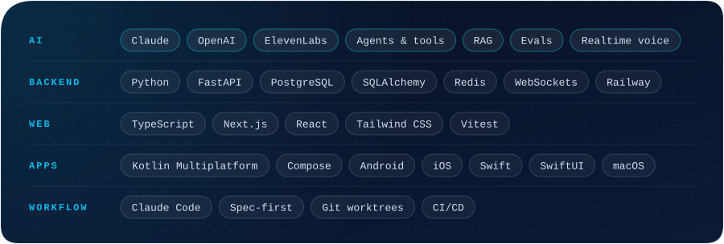

  
  
  
  

I'm Mohi, founder of **[FaydenAI](https://faydenai.com)**, an AI studio based in Vancouver. I build AI products end to end, from the model calls and the backend to the web and the Android and iOS apps. I make AI courses, and I help teams ship AI features that hold up in production.

## Now building

  
  

  

## How I build

- **AI that does the work.** Products are built around a model doing a real job end to end, not a chatbot bolted onto the side.
- **Spec first.** Every feature starts as a written spec, and the spec stays the source of truth as the code changes.
- **One problem, one audience.** Scoped tight, shipped fast, and no claim I can't back up.
- **Craft is proof.** Design quality is part of the product, not a coat of paint at the end.
- **Your words stay yours.** User data is private by default, deletable, and never trains a model without consent.

## Toolbox

## In the workshop

Native Mac tools I build for my own workflow, including the pipeline behind the course videos:

- **Record Studio**: a voice-following teleprompter that records the take. The lessons are filmed in it.
- **MoniLight**: turns spare monitors into soft lights for the camera while I record.
- **Spec Map**: a live map of a product's features, read straight from its specs.
- **TermRail**: terminals grouped by project, with every group one click away.
- **Crisp**: a menu-bar refiner that cleans up dictated text without rewriting it.
- **Interlude**: gentle, guided micro-breaks that pull me away from the screen to rest my eyes and move.

## Background

My roots are in mobile. At Instacart I built payments and commerce features for the Instacart app, then intelligent features for Caper, Instacart's AI-powered smart carts. Before that I led the Android team at RxPx in digital health, moving the app to modern architecture and Jetpack Compose. Teaching has run alongside all of it, from one-on-one tutoring to YouTube, and that's where the courses come from.

  Have an AI feature to ship? <a href="https://faydenai.com/contact">Let's talk.</a>

